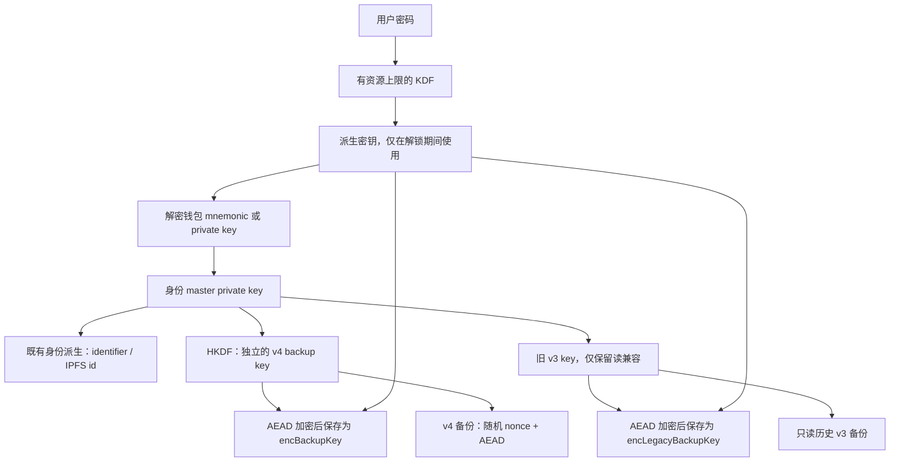

# infrastructure #690：备份、xpub、KDF 与 HID/APDU 边界

关联：[infrastructure#690](https://github.com/consenlabs/infrastructure/issues/690)。修复直接基于 `main@eeda742`，保留仓库 `nightly-2023-06-15` 和既有链/SDK依赖；仅增加 Argon2id 与轻量 AEAD 所需依赖。

## 核查结论

| 问题 | 当前基线结论 | 本次处理 |
| --- | --- | --- |
| `identity.encKey` 可直接解密 IPFS v3 备份 | 存在。它是加密/签名私钥的明文 hex，名字中的 enc 不代表已加密 | 新存储只写受钱包凭证保护的 AEAD 密钥包；新版备份使用独立于旧 `encKey` 的密钥 |
| xpub 的默认固定 key/IV 与 CBC | 存在。软件钱包、imKey 通用、BTC、BTC fork、CKB 都可达 | 移除默认值；调用方显式配置 key，新写入使用随机 nonce 的 AEAD |
| KDF 参数无资源上限 | 存在。当前 main 尚未限制资源用量和最低强度 | 新增资源上限、最低强度识别及认证后的完整重加密升级 |
| HID/APDU 的长度与切片 | 存在。HID 长度高字节计算、短包、序号及响应格式边界不充分 | checked arithmetic、严格长度/序号/通道/hex 校验及畸形输入回归 |

## 密钥生命周期

旧版 `encKey` 仅允许反序列化；序列化不再写该字段。新钱包和迁移后的钱包存储 `encBackupKey`、`encLegacyBackupKey`，均由钱包 KDF 派生密钥的前 32 bytes 通过 HKDF 和独立用途标签加密。前 32 bytes 对应历史 AES/MAC 契约；32-byte 缓存 DK 与密码生成的 64-byte DK 规范化为同一 wrapping key，未认证的 DK 尾部不影响持久化密钥包。`encAuthKey`、`encOriginal` 在 KDF 升级时也完整重封装，identifier 与 IPFS id 保持兼容。旧 `encKey` 与新版 v4 key 使用独立派生方式，持有旧 `encKey` 不能解密 v4。

新版备份 API 的 `EncryptDataToIpfsParam`、`DecryptDataFromIpfsParam` 增加 `password=3` / `derivedKey=4` 的 oneof。缺少凭证返回 `missing_key`，错误凭证拒绝。历史消息仍可解码，但不会继续执行无凭证备份操作。旧钱包的弱 KDF 必须以密码升级；仅提供历史 derived key 返回 `kdf_upgrade_requires_password`，避免静默改变调用方缓存的凭证。

## 格式与客户端接入

轻量共用 crate 为 `common/security-crypto`，仅依赖既有版本或 Rust 2023 兼容的 AEAD/HKDF 原语；不依赖钱包、设备或链代码。共享 envelope 为 `tcx-aead-v1:` + hex(`nonce[24] || ciphertext || tag[16]`)。算法为 XChaCha20-Poly1305；密钥经 HKDF-SHA256 派生，salt 为 `token-core/authenticated-encryption/v1`，info 与 AAD 都使用对应用途标签。

| 数据 | 原始 key 来源 | HKDF info 与 AAD |
| --- | --- | --- |
| xpub | 调用方配置的 16 或 32-byte hex key | `token-core/xpub/v1` |
| 存储的现代备份 key | 钱包派生密钥前 32 bytes | `identity/backup-key/v4` |
| 存储的历史备份 key | 钱包派生密钥前 32 bytes | `identity/legacy-backup-key/v3` |
| v4 备份正文 | 独立现代备份 key | `ipfs/backup/v4/{identifier}` |

现代 backup key 本身从身份 master private key 以相同 HKDF salt、info `identity/backup-key/v4` 派生；旧 v3 key 保持原 HMAC 派生，仅用于历史读取。IPFS 新写入在 envelope 前增加 `04` 版本标记；旧 hex `03...` 仍经原签名验证后解密。

xpub 新结果直接返回 envelope。固定 IV 初始化参数只为历史解密保留，新加密不再使用。`ikc_common::utility::decrypt_xpub_with_key_iv` 支持新格式与旧 base64 CBC，供客户端迁移参考。16-byte 配置保留原有 128-bit 密钥强度，推荐调用方生成并妥善保存独立随机 32-byte key；不能继续把公开测试样例作为生产秘密。升级客户端解密逻辑后再启用新 core；旧 CBC 客户端无法读取新结果。xpub 是隐私数据，不等同于可签名私钥。

## 可运行的迁移顺序

1. 对当前 `walletsV2` 中的每个钱包，使用 `WalletKeyParam` 调用新增 `upgrade_keystore_security`。需要弱 KDF 升级时传密码；成功后返回 `GeneralResult.isSuccess=true`。它保持钱包 ID、原始备份、身份标识与链上密钥不变，原子替换磁盘文件。升级失败不会替换内存钱包，写入失败不会截断原文件。升级后旧 cached derived key 失效，调用方应清理缓存并重新获取。
2. 仅有旧 `wallets/identity.json` 时，先按现有 `migrate_keystore(MigrateKeystoreParam)` 传 `id="identity"`、原身份 network 与 password（文件名为 `identity.json`，其自身含加密助记词）迁移该身份的助记词钱包，再调用带凭证的 IPFS API 或 `upgrade_keystore_security`。直接访问 identity-only 明文 `encKey` 的路径返回 `backup_security_migration_required`。集成测试分别使用真实 v10000 identity-only fixture 和 v11000 钱包 fixture，验证迁移前后的 identifier/IPFS id 及已有 v3 密文读取。
3. 从旧存储读取 v3 明文，再通过新版 `encrypt_data_to_ipfs` 产生 v4 密文；调用方上传新对象并确认可恢复后，更新引用、删除旧远端 v3 对象。完成所有身份钱包迁移后，按现有身份清理流程清除旧本地钱包及 `identity.json`。

本地代码不能撤回已经外泄的旧备份密钥，也不能删除应用掌管的远端对象。若旧 `encKey` 已泄露，旧 v3 备份仍可被解密；只有重加密及旧对象清理完成后，历史备份风险才闭环。不要把本 PR 的合并视为已经完成远端数据轮换。

## KDF 策略

兼容读取仍接受资源上限内的历史 PBKDF2/scrypt/Argon2 参数。新建钱包默认 Argon2id `m=19456 KiB,t=2,p=1,dklen=64`。最低安全强度识别使用：PBKDF2 ≥600000 rounds；scrypt `N≥2^17,r≥8`；Argon2id `m≥19456 KiB,t≥2`。低于门槛的历史钱包可先认证再升级到默认 Argon2id，绝不通过降低参数“修复”错误。

新增资源上限约束：PBKDF2 ≤10000000 rounds；scrypt 内存≤512MiB、work factor≤2^22、r≤32、p≤16；Argon2id 内存≤256MiB、t≤10、p≤16；salt 16..64 bytes、dklen 32/64。`KDF_ROUNDS=1` 只用于测试的兼容路径，不改变新建钱包默认 Argon2id 策略。

Polkadot.js 外部 keystore 继续按其固定 `N=2^15,r=8,p=1` 格式兼容读取/导出；在构造 KDF 前先检查完整头长度及参数常量，异常输入不进入 KDF。导入本地钱包后采用默认 Argon2id 存储。该外部格式不自动提高参数以免破坏 PJS 互操作；其 nonce、PKCS8 长度/标记也做显式边界检查。

## HID/APDU 验证边界

HID 将声明长度作为大端 u16 解析，限定最大消息 7609 bytes，校验首包/续包完整长度、通道、命令与递增序号；拒绝短写、短读、超时值溢出与不一致声明；整条 HID 消息共用一个超时截止点，续包不能逐包重置超时。APDU chunk 长度使用 usize 计算，空输入不再做下溢减法，完整响应必须是合法 hex。

已增加 HID 六组测试（含 2080 个确定性畸形包和 256/511/7609 边界），及 APDU 负例。未连接真实设备，未执行需要授权的硬件签名/HID 回归；这部分仍需真实 imKey Pro 确认。

## 回归验证

- 共享 AEAD：随机性、错误 key、用途隔离、全部截断、篡改与历史 xpub 解密。
- keystore：错误密码不改状态、弱参数升级、所有辅助字段重封装、原始备份及身份保持、序列化不含明文 key、旧泄露 key 不能读取 v4、磁盘重载后恢复。
- IPFS API：缺凭证/错误凭证拒绝，旧钱包迁移后 v3 备份可读，新写入 v4，显式升级 API 成功。
- 固定 CBC xpub 向量的断言改为新旧密文解密后比较同一预期 xpub，保留地址与公钥原有兼容断言。
